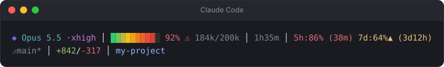

# claude-code-statusline

A two-line status line for [Claude Code](https://code.claude.com/docs/en/statusline), set up for Windows with Git Bash.


Based on [kcchien/claude-code-statusline](https://github.com/kcchien/claude-code-statusline). See [Changes from upstream](#changes-from-upstream) for what this fork adds.

## What it shows

**Line 1**

| Part | Example | Notes |
|---|---|---|
| Model + effort | `◆ Opus 5.5 ·high` | Effort colour: low grey, medium green, high yellow, xhigh magenta, max red. Hidden when the model has no effort setting. |
| Context bar | `█░░░░░░░░░ 12%` | Green → yellow → red gradient. The percentage turns yellow at 70%, and red with `⚠` at 90%. |
| Tokens used / window | `120k/1M` | The same count and colour as the percentage |
| Elapsed time | `14m32s` | Hidden at 0. Hours and minutes after the first hour (`1h35m`). |
| Rate limits + time to reset | `5h:23% (2h13m) 7d:41% (3d4h)` | Turns red at 80%. `▲` (yellow) is the pace marker, see below. Shown only when you log in with a claude.ai Pro/Max account. |

**Line 2:** git branch (with `*` when there are uncommitted changes, new files included), lines added/removed this session, current folder, and a worktree/agent tag when one is active.

Near the limits, the warning colours take over. Here the context is at 92% (red, with `⚠`) and the 5h window is at 86%, resetting in 38 minutes:



The 7d window here has the pace marker `▲`. 64% of the limit is used, but only half of the week has passed. At this rate the limit runs out before the window resets. The marker comes on when the used percentage is higher than the percentage of the window that has passed. It is not shown in the first 10% of a window (30 minutes of the 5h window), because one large request early on would set it off.

## Requirements

- Windows with [Git for Windows](https://git-scm.com/download/win) (provides Git Bash)
- Claude Code
- A terminal with truecolor support for the gradient (Windows Terminal works). Other terminals fall back to 16 colours.

`jq` is required. The installer downloads the official jq 1.8.1 release and checks its SHA-256, so you don't need to install it yourself.

## Install

```powershell
git clone https://github.com/syntaxerror00100/claude-code-statusline.git
cd claude-code-statusline
powershell -ExecutionPolicy Bypass -File .\install.ps1
```

Or from Git Bash:

```bash
bash install.sh
```

Then restart Claude Code.

The installer:

1. Downloads `jq.exe` to `%USERPROFILE%\.claude\bin\` (only if it isn't there already)
2. Copies `statusline.sh` to `%USERPROFILE%\.claude\statusline.sh`
3. Sets the `statusLine` entry in `%USERPROFILE%\.claude\settings.json`, keeping all your other settings
4. Prints a sample status line so you can see it works

Before it changes anything, it saves a timestamped `.bak-YYYYMMDD-HHMMSS` copy of your existing `settings.json` and `statusline.sh`. If `settings.json` is not valid JSON, the installer stops and changes nothing.

### Manual install

1. Copy `statusline.sh` to `%USERPROFILE%\.claude\statusline.sh`
2. Put [`jq.exe`](https://github.com/jqlang/jq/releases) at `%USERPROFILE%\.claude\bin\jq.exe` (or anywhere on your `PATH`)
3. Add this to `%USERPROFILE%\.claude\settings.json`, using your own user name:

```json
"statusLine": {
  "type": "command",
  "command": "\"C:\\Program Files\\Git\\bin\\bash.exe\" \"C:/Users/<you>/.claude/statusline.sh\"",
  "refreshInterval": 60
}
```

### macOS / Linux

The script comes from a cross-platform upstream and should work there too, but this fork has only been tested on Windows. Install `jq`, copy the script, and point Claude Code at it:

```bash
cp statusline.sh ~/.claude/statusline.sh && chmod +x ~/.claude/statusline.sh
```

```json
"statusLine": {
  "type": "command",
  "command": "bash ~/.claude/statusline.sh",
  "refreshInterval": 60
}
```

## When it updates

Claude Code doesn't run the status line continuously. It runs the script after each Claude reply, after `/compact`, when you change permission mode, and when a rate-limit window resets.

- **Usage percentages** come from Claude's servers with each reply. Usage from other places (claude.ai in the browser, other Claude Code windows) shows up only after this session's next reply.
- **The reset countdown** uses your PC's clock. Without a timer it would freeze while you're idle, so the installer sets `"refreshInterval": 60` to re-run the script every minute. Remove that line if you don't want the timer. The countdown will then update only on events.

## Options

Set these as environment variables:

| Variable | Effect |
|---|---|
| `CLAUDE_STATUSLINE_ASCII=1` | Plain ASCII symbols |
| `CLAUDE_STATUSLINE_NERDFONT=1` | Nerd Font icons (needs a Nerd Font) |
| `CLAUDE_STATUSLINE_POWERLINE=1` | Powerline separators (on by default with Nerd Font) |

## Uninstall

Remove the `statusLine` block from `%USERPROFILE%\.claude\settings.json`, or restore the `settings.json.bak-*` file the installer made. Then delete `%USERPROFILE%\.claude\statusline.sh`.

## Changes from upstream

- **Windows support:** runs under Git Bash and finds `jq.exe` in `~/.claude/bin`. It strips the CRLF that jq outputs on Windows.
- **Fixed Windows paths:** the upstream `printf '%b'` turned the `\r` in `C:\repos` into a carriage return. Colours are now real escape bytes printed with `%s`. The folder segment also splits on `\`, so it shows the folder name and not the full `C:\...` path.
- **Reset countdown:** shows the time left before the 5h and 7d limits reset.
- **Pace marker:** `▲` when you use a rate limit faster than its window passes.
- **No session cost:** removed the `$` segment. For Pro/Max it is an API-equivalent price, not what you pay.
- **Git status:** one cache file per folder, in `~/.cache/claude-statusline` instead of a shared `/tmp`, so windows open in different repos no longer show each other's branch. New (untracked) files now count as changes for the `*`.
- **Effort level:** shows the reasoning effort next to the model name.
- **Token count:** shows tokens used out of the window size (`120k/1M`).
- **Folder colour:** the folder name uses a lighter blue that's easier to read on dark backgrounds.
- **Installer:** a Windows installer that merges into `settings.json` without rewriting your other settings.

## License

MIT. See [LICENSE](LICENSE). The original work is © KC Chien.
